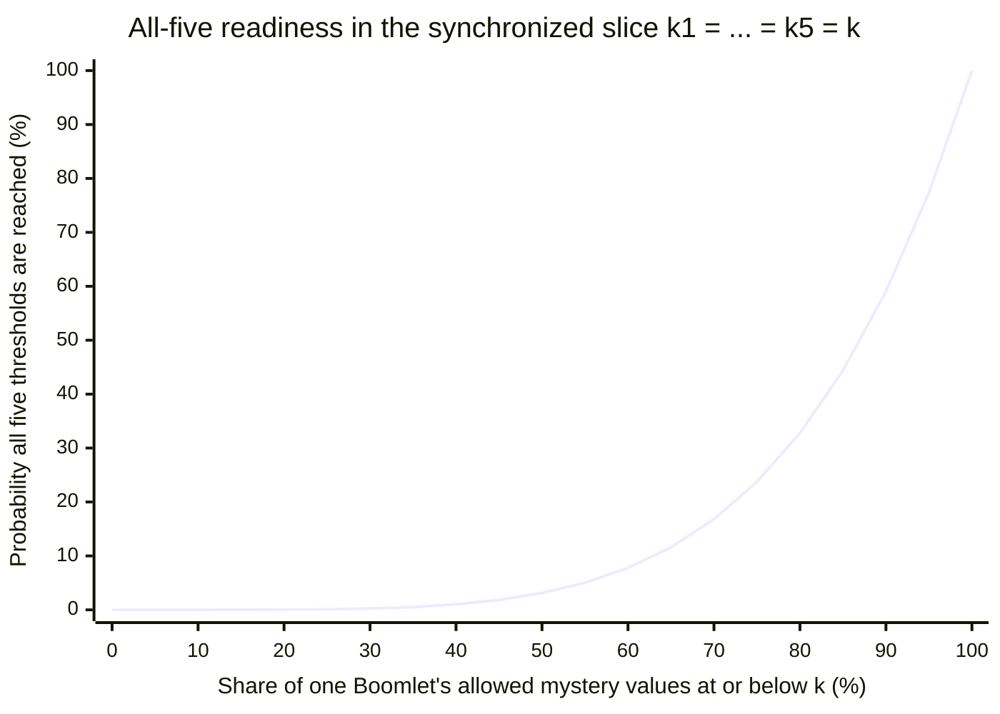
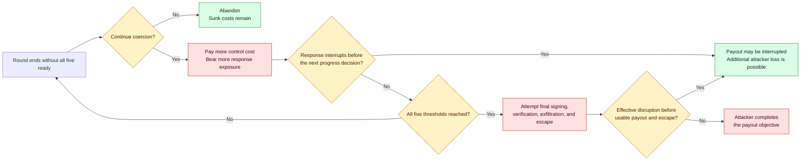

# Boomerang design

Boomerang is an unfinished Bitcoin cold-storage protocol design for a threat
model that includes planned physical coercion. It is not production-ready.
This document is the technical companion to the
[first-contact README](README.md). Sections 1–6 build the concept, Sections
7–11 describe the protocol realization, and Sections 12–16 cover the economic
argument, boundaries, and status. The
[protocol specification](spec/SPEC.md) is normative for exact behavior and
controls wherever the two differ.
The generated [wire catalog](wip/wire_catalog.txt) provides the corresponding
ASCII packet layouts, field IDs, and size formulas.

## Contents

1. [Attack lifecycle](#1-attack-lifecycle)
2. [Design objective](#2-design-objective)
3. [Existing controls and the remaining problem](#3-existing-controls-and-the-remaining-problem)
4. [The composed mechanism](#4-the-composed-mechanism)
5. [End-to-end coercion scenario](#5-end-to-end-coercion-scenario)
6. [Protocol sequence](#6-protocol-sequence)
7. [Architecture and trust boundaries](#7-architecture-and-trust-boundaries)
8. [On-chain construction](#8-on-chain-construction)
9. [What setup establishes](#9-what-setup-establishes)
10. [Withdrawal in detail](#10-withdrawal-in-detail)
11. [Duress protection and observability](#11-duress-protection-and-observability)
12. [Attack economics and security argument](#12-attack-economics-and-security-argument)
13. [Engineering constraints and trade-offs](#13-engineering-constraints-and-trade-offs)
14. [Failure and human-safety boundaries](#14-failure-and-human-safety-boundaries)
15. [Ancillary procedures and open protocol work](#15-ancillary-procedures-and-open-protocol-work)
16. [Design status and verification path](#16-design-status-and-verification-path)

## 1. Attack lifecycle

A coercion attack is a transaction workflow imposed on people. Thinking only
about whether an attacker can obtain a key misses the outcome the attacker
needs and the period during which that outcome can still be disrupted.

**Targeting.** The attacker first identifies a valuable holding and the people,
places, devices, services, and relationships involved in spending it. Public
wealth signals, breached customer data, insider information, and ordinary
surveillance can all turn an anonymous on-chain balance into a physical target.
Geographic separation and multiple custodians may increase reconnaissance and
coordination costs, but an informed attacker may plan around them.

**Control.** The attacker gains enough physical control to issue demands,
observe behavior, restrict communication, and keep the required participants
available. Control may extend to homes, workplaces, family members, phones, and
wallet equipment. The longer control is maintained, the more resources and
exposure the attacker bears and the longer the victims remain in danger.

**Compelled transaction authorization and signing.** The attacker dictates a
destination and forces the participants first through review of the real
unsigned transaction, then through any pre-signing protocol authorizations,
and, once the wallet permits it, through final Bitcoin signing. In a mature
attack, the coercer may know the custody policy and may insist on every required
signer, recovery artifact, or ceremony step. A defense cannot assume that a
victim will refuse, lie successfully, forget a secret, or retain an unobserved
communication channel.

**Verification.** A payout-seeking attacker wants evidence that cooperation
produced the intended transfer. They can inspect transaction details, compare
addresses and amounts, and watch for broadcast or confirmation. A decoy that
cannot survive that verification does not end the attack.

**Exfiltration and escape.** After broadcast, the attacker may wait for
confirmation, move proceeds through additional transactions or services, and
leave the coercion site. Their objective is a usable, verifiable payout
together with a viable exit rather than merely possession of credentials.

Boomerang focuses on this complete lifecycle. The interval between compelled
authorization and usable payout is where the protocol seeks to change the
attacker's decision and give a prearranged responder an opportunity to act.

## 2. Design objective

The objective is to prevent compelled human cooperation from reliably
producing a prompt payout. Its earliest Taproot script branch is the
five-of-five Boomerang branch, available no earlier than
`milestone_block_0`. Bitcoin checks that timelock and the five signatures; the
Boomlet devices withhold their parts of those signatures until an off-chain
withdrawal state machine has completed. The people cannot accelerate its
progress.

A coerced withdrawal therefore becomes an operation with an uncertain
completion time, and the same ceremony that withholds signing progress includes
repeated covert duress checks whose results are sent to a prearranged responder.
A payout-seeking attacker must bear time, cost, exposure, and response risk
without knowing when completion becomes possible, while the responder gains an
interval in which to act.

The intended result is a less dependable coercion payoff and a meaningful
response opportunity. If no credible response exists, or if extending the
event only increases danger, consuming more time is not itself a safety
property.

## 3. Existing controls and the remaining problem

Familiar custody controls address important threats, and several belong in a
sound Boomerang deployment.

**Multisignature** removes a single signing key as the sole point of failure. It
can limit remote theft, insider action, and accidental loss by requiring
independent signatures. Against a coercer who has discovered the policy and can
control the threshold number of people, however, multisignature can reduce the
attack to collecting the participants, compelling valid signatures, and
verifying the transaction.

**Geographic distribution of custodians and keys** makes simultaneous
compromise harder, limits some site disasters, and forces an attacker to
coordinate across locations. It can reduce targeting risk when locations and
identities remain private. Once those facts are learned, distance may increase
the attacker's logistics without changing the final rule that enough compelled
participants can authorize a spend.

**Fixed withdrawal delays** impose a known waiting period between initiating a
withdrawal and allowing the requested transfer to complete. This interval
allows time for detection, cancellation, or response. Its known duration also
lets an informed attacker choose when to begin, estimate how long control must
last, and decide in advance whether the expected payout justifies that interval.

**Decoys and deniable balances** may end opportunistic attacks when the coercer
does not know what exists and accepts the apparent payout. They are weaker
against prior knowledge, on-chain analysis, leaked records, repeated demands,
or an attacker who can verify that the transfer does not match the target they
identified. A failed decoy may also escalate harm.

**Vault constructions** can precommit destinations, provide recovery paths, or
place a delay between an initiating action and unrestricted spending. Those
properties are valuable against key theft and detected unauthorized spends.
Depending on the construction, a fixed and observable recovery window may
still be plannable, and a vault does not by itself provide a covert physical-
duress signal or a prepared real-world response.

[BIP 345, `OP_VAULT`](https://bips.dev/345/) is a closed consensus proposal for
a covenant with a fixed delayed withdrawal and a prespecified recovery path.
Its known response interval contrasts with Boomerang's off-chain,
per-withdrawal thresholds. Boomerang does not depend on the proposal.

The remaining problem is therefore an informed coercer who can demand genuine
cooperation and verify the result. Boomerang combines multiple custodians,
isolated keys, on-chain timelocks, trusted devices, and an external response
service to address that problem. It is meant for situations where preventing
silent remote key theft is necessary but insufficient.

## 4. The composed mechanism

The on-chain layer uses the current profile's earliest Taproot script branch,
the five-of-five Boomerang branch at `milestone_block_0`. Each peer has a
recoverable normal key and a second signing share held by a trusted device
called a **Boomlet**. A peer's two public parts form its Boomerang public key;
Bitcoin requires a signature under all five such keys on this branch. The host
cannot read or directly use the Boomlet's private material. An authorized setup
flow can export that material only inside an authenticated envelope bound to
one designated backup device, called a **Boomletwo**.

The transaction authorization layer combines independent review on the
**Secure Terminal** (`ST`) with unanimous Boomlet approval. One peer supplies
the transaction as the **initiator**; the remaining four are the
**non-initiators**. ST gives the Boomlet a nonce-bound protocol confirmation of
the reviewed `tx_id`, and the Boomlet produces a `TxApproval` bound to the
active withdrawal. The **Watchtower** (`WT`) collects one valid approval from
each peer. Every participant verifies the ordered five-`TxApproval` set and
derives the same `approved_withdrawal_id`; attestations establish that the four
non-initiators received and verified the complete set and agreed on the result.

The concealed signaling layer combines private ST input, encrypted
`placeholder` values, WT routing, and each peer's setup-bound **Search and
Rescue service** (`SAR`). A safe response and a structurally valid duress
response produce the same protocol artifact and follow the same
protocol-visible handling. Each signed `TxCommit` binds its `placeholder` to
the approved withdrawal. Each SAR deployment configures a fixed acknowledgment
delay. When SAR receives a complete placeholder request, it records the receipt
time and schedules acknowledgment release for that time plus the delay. For
both valid safe and duress placeholders, SAR releases the acknowledgment at
the scheduled time only after the required processing and durable write. If
processing misses that time, SAR sends no late acknowledgment and exposes the
same failure for both classifications. Each retry is timed from its own
receipt. A Boomlet requires its own acknowledgment along with the complete
signed `TxCommit` collection before progress can begin.

The completion layer is enforced by the Boomlets. On entry to `DIGGING`, each
Boomlet draws a fresh private `mystery` from the implementation profile's
bounds. This value is the required number of successful local `counter`
increments. Valid `ping` and `pong` exchanges can advance that `counter` only
with chain progress, current peer traffic, and a SAR acknowledgment for a fresh
`placeholder`. Recurring consent checks use the same message and acknowledgment
sequence. Final signing remains unavailable until all five Boomlets have
reached their private thresholds.

The attacker must sustain the progress traffic to reach signing. The progress
protocol repeatedly requests duress input and requires a durable SAR
acknowledgment for each resulting `placeholder`. The unknown per-device
thresholds deny the coerced people a way to promise a precise finish or make it
arrive sooner. The resulting interval is valuable only to the extent that SAR
and the surrounding response plan can use it.

Bitcoin does not validate `mystery` or `counter` state, duress checks,
acknowledgments, or the `DIGGING` state machine. Trusted hardware and the
off-chain protocol enforce those rules. Bitcoin consensus enforces the Taproot
spending conditions and absolute timelocks. An implementation that changes the
trust boundaries or message semantics can therefore preserve the same-looking
on-chain output while implementing a materially different security model.

## 5. End-to-end coercion scenario

Before any attack, five peers complete setup. Each peer operates an isolated
environment (**Iso**) for sensitive key work, a networked environment
(**Niso**) for coordination, a Boomlet, an air-gapped Secure Terminal (`ST`) for
trusted display and input, and a Phone for registering encrypted rescue data.
Each selects one SAR. The group agrees on peer identities, a WT, milestone
blocks, a descriptor, and a setup instance. Each Boomlet enrolls a five-country
safe set drawn from the fixed 193-entry display vocabulary, and each user
memorizes that set. Setup also creates and verifies the target-bound Boomletwo
backup.

An attacker later takes control of the five users and demands payment to a
specific address. The attacker has enough knowledge to reject a decoy and
watches the transaction review and protocol coordination. This scenario still
assumes that the attacker cannot observe the ST consent interaction
closely enough to learn or dictate the safe response. An attacker who learns or
dictates that response can force later consent checks to evaluate as safe.

The initiator presents the attacker's demanded unsigned transaction. Each user
independently confirms its `tx_id` on ST, and each Boomlet sends a
`TxApproval`. After WT distributes the complete ordered approval set, all five
Boomlets derive the same `approved_withdrawal_id`; the four non-initiators send
attestations that they received and verified the set and agreed on the result.

The initiator can answer the initial private consent challenge and send its
`TxCommit` while WT collects and verifies those attestations. The user can
enter the memorized safe set or signal duress while continuing the required
flow. WT may stage the initiator's commit but does not relay its `placeholder`
until all four attestations pass. WT then obtains the initiator's SAR
acknowledgment and provides the WT-signed initiator commit to the
non-initiators. Each non-initiator answers the same challenge and sends a
`TxCommit`; WT routes each encrypted `placeholder` to the corresponding SAR.
A Boomlet enters `DIGGING` after receiving the complete signed `TxCommit`
collection and its own SAR acknowledgment, then generates its private
`mystery`.

The attacker can compel the participants to continue, but cannot inspect the
private `mystery` values, command `counter` increments, bypass the peer and SAR
gates, or obtain final signatures early. In each progress round, every Boomlet
sends a fresh `ping` carrying a new `placeholder`. WT obtains the corresponding
SAR acknowledgment and returns a recipient-specific `pong` containing the
other peers' current `ping` messages. A valid round can advance the local
`counter`, and recurring consent challenges provide further opportunities to
signal duress.

The attacker must keep the participants and dependencies available while
completion remains unknown. Protocol traffic reveals continued progress but
does not reveal whether a valid consent response was safe or duress. If an
effective response reaches the victims before signing and payout, it may
disrupt the attack.

Once WT holds a current reached `ping` from all five Boomlets and distributes
the `reached_pings_collection`, final signing can begin. If the response has
not interrupted the ceremony, the attacker can proceed through final signing,
verification, exfiltration, and escape.

## 6. Protocol sequence

The diagram summarizes the withdrawal phases and the security-critical gates
between the initiator and non-initiators. Each required step shown withholds
signing, transmits a `placeholder` that SAR must acknowledge, or does both.
Validation checks, retries, and wire-level detail are omitted.
[Section 10](#10-withdrawal-in-detail) describes the omitted checks and retries.
The [withdrawal subsystem](withdrawal/README.md) contains the message-level
sequence diagrams.

```mermaid
sequenceDiagram
    actor U as Five users
    participant B as Five Boomlets
    participant WT as Watchtower
    participant SAR as Each peer's SAR

    U->>B: Each user independently confirms the exact tx_id
    B->>WT: Five signed TxApprovals
    WT-->>B: Ordered five-approval set
    Note over B,WT: Every peer verifies the set and derives approved_withdrawal_id

    par Initiator may prepare early
        U->>B: Initiator enters its consent response on ST
        B->>WT: Staged initiator TxCommit + encrypted placeholder
    and Non-initiators prove receipt and agreement
        B->>WT: Four signed approval-set attestations
    end
    Note over U,B: Safe and duress inputs differ physically if observed
    Note over WT: Verify all four attestations before relaying the initiator placeholder or accepting other commits
    WT->>SAR: Initiator's exact placeholder
    SAR-->>WT: Exact acknowledgment after fixed-shape durable write
    WT-->>B: WT-signed initiator commitment

    U->>B: Non-initiators enter their consent responses on ST
    B->>WT: Four signed TxCommits + encrypted placeholders
    WT->>SAR: Each non-initiator's exact placeholder
    Note over WT,SAR: Valid safe and duress use the same routing and fixed acknowledgment delay from receipt,<br/>durable-write path, retries, and visible failure behavior
    SAR-->>WT: Exact acknowledgments
    WT-->>B: Complete five-commit collection + each Boomlet's acknowledgment
    Note over B: Verify both, enter DIGGING,<br/>and independently draw fresh mysteries

    loop Until all five local thresholds are reached
        opt A round selected for a recurring challenge
            U->>B: User enters a fresh consent response
        end
        B->>WT: Signed ping + freshly encrypted placeholder
        WT->>SAR: Exact placeholder
        SAR-->>WT: Acknowledgment required before pong use
        WT-->>B: Recipient-specific pong with current peer pings
        Note over B: A valid catch-up round need not increment the local counter
    end

    WT-->>B: Signed reached collection for all five Boomlets
    U->>B: Isolated signing; all five must sign
    B->>WT: Five Bitcoin signature fragments
    WT->>WT: Aggregate, verify, broadcast
```

## 7. Architecture and trust boundaries

The specified profile is exactly five peers with a five-of-five Boomerang
branch. Each peer's Iso holds or reconstructs the mnemonic-backed normal key.
Niso is online, talks to peers and WT over Tor, and obtains a Bitcoin chain
view. Boomlet holds the host-inaccessible identity and MuSig2 private material,
long-lived protocol state, and active withdrawal state. ST is trusted to
display transaction identifiers and receive duress input. Phone registers and
updates encrypted rescue data. Boomletwo is an inactive backup target.

Iso keeps no durable protocol state. It reconstructs the normal key when needed
and holds only session-scoped setup-relay, backup-verification, and signing
state, which it may lose between ceremonies; a lost signing or verification
exchange fails closed rather than silently continuing
([SPEC §7.2](spec/SPEC.md)). Niso persists the Bitcoin RPC configuration,
Boomlet-provided Tor identity material, peer reachability records, and active
setup and withdrawal relay state, and it is never trusted to authorize
spending ([SPEC §7.3](spec/SPEC.md)).

WT is a non-custodial coordinator that relays `placeholder` values, supplies a block-
height view, aggregates final fragments, and broadcasts. It can censor, delay,
equivocate, or leak metadata. Each peer binds one SAR identity during setup; WT
cannot silently substitute another. SAR is also non-custodial but can stall
progress by withholding an acknowledgment and can fail operationally after
receiving a signal.

### Need-to-know exposure

The services see as little as their roles require. WT stores registered setup
agreements, peer identity keys, SAR routing information, active ceremony
identifiers, protocol objects, receipts, and replay state. It does not store the
descriptor or the milestone schedule, and every PSBT it relays is encrypted for
its recipient Boomlet ([SPEC §7.4, §13.8, §15.3](spec/SPEC.md)). SAR
stores a pseudonymous `doxing_data_identifier`, `dynamic_update_auth_key`,
encrypted rescue data and upload receipts, payment status, and `placeholder`
replay tuples; it
gains the ability to decrypt the rescue data only when a valid duress
`placeholder` delivers `doxing_key_for_sar`
([SPEC §7.5, §16.3–16.4](spec/SPEC.md)). A SAR that learns identifying data
during an event could later misuse it.
[Section 14](#14-failure-and-human-safety-boundaries) analyzes that risk.

### Trust assumptions

The design assumes Iso is trusted and isolated during setup and final signing,
Boomlet enforces key and state boundaries, ST preserves display and input
integrity, cryptographic primitives and random generation are correctly
implemented, and at least one peer remains honest and follows the Boomerang
path during setup. Niso and the
ordinary host are not trusted to authorize spending. Transaction identifiers,
setup and withdrawal identifiers, the ordered five-`TxApproval` set, the four
non-initiator approval-set attestations, sequence numbers, freshness checks,
signing-package checks, and final transaction revalidation preserve
authorization continuity across those boundaries.

### Topology

Peers and WT communicate over Tor onion services. Phone talks only to its
selected SAR, using the onion address in `SarId`. Each Niso keeps its own
Bitcoin RPC chain view. The air-gapped ST exchanges encrypted messages with
Boomlet over a host-relayed channel rather than a network connection. The
security models contain the authoritative pictures. The
[trust-boundary diagram](security_models/architecture.md#trust-boundaries-and-diagram)
and the
[data-flow diagram](security_models/architecture.md#architecture--data-flows)
map every component, boundary, and flow.

## 8. On-chain construction

For peer `i`, the Boomerang public key aggregates the peer's two signing parts
under MuSig2 as shown below.

```text
boom_pubkey_i =
  derive_musig2_public_key(
    boomlet_musig2_pubkey_share_i,
    normal_pubkey_i
  )
```

The Taproot internal key is unspendable, so only script paths can spend. In
the policy notation, `pk(key)` requires a valid BIP342 signature for `key`;
`thresh(k, expressions)` requires at least `k` listed expressions;
`after(height)` requires the transaction `nLockTime` to satisfy the absolute
block-height lock and all input sequences to permit lock-time enforcement;
`and(left, right)` requires both. The script tree contains the following
branches.

```text
and(thresh(5, pk(boom_pubkey_0)..pk(boom_pubkey_4)),
    after(milestone_block_0))

and(thresh(5, pk(normal_pubkey_0)..pk(normal_pubkey_4)),
    after(milestone_block_1))

and(thresh(4, pk(normal_pubkey_0)..pk(normal_pubkey_4)),
    after(milestone_block_2))

and(thresh(3, pk(normal_pubkey_0)..pk(normal_pubkey_4)),
    after(milestone_block_3))

and(thresh(2, pk(normal_pubkey_0)..pk(normal_pubkey_4)),
    after(milestone_block_4))

and(thresh(1, pk(normal_pubkey_0)..pk(normal_pubkey_4)),
    after(milestone_block_5))
```

[SPEC §11](spec/SPEC.md) defines the normative form. The descriptor is
constructed deterministically from the ordered peer keys and the milestone
struct, and every peer compares the exact descriptor string and the underlying
Taproot output key during setup.

Milestones are strictly increasing setup parameters, and the Boomerang branch
is the earliest spendable branch called the primary branch. The current protocol
requires a Boomerang withdrawal to begin only at or after
`milestone_block_0` ([SPEC §15.1](spec/SPEC.md)).

Normal-key fallback begins at `milestone_block_1`, the second milestone;
`milestone_block_0` gates only the Boomerang branch. The first fallback branch
requires all five normal keys. Four-of-five, three-of-five, two-of-five, and
one-of-five normal-key branches then become available at `milestone_block_2`
through `milestone_block_5`. Once their timelocks are satisfied, these
branches do not require Boomlet `mystery` values, WT/SAR acknowledgments, or the
Boomerang withdrawal state machine. Bitcoin consensus enforces these script
conditions and absolute timelocks. Trusted hardware and the off-chain protocol
enforce the remaining withdrawal rules.

## 9. What setup establishes

Setup installs the long-lived key material, pairs ST, enrolls the five-country
consent set using the 193-entry vocabulary, authenticates peer records, agrees
the ordered peers and milestone blocks, constructs the descriptor, binds the
WT and each peer's SAR, registers service receipts, completes the target-bound
Boomletwo backup, and produces a final chained setup checkpoint. Each Boomlet
tracks that progress through the fixed state chain shown below
([SPEC §12](spec/SPEC.md)).

```text
EMPTY
  -> INSTALLED
  -> ST_ENROLLED
  -> PARAMS_REVIEWED
  -> PARAMETERS_AGREED
  -> WT_READY
  -> SAR_READY
  -> BACKUP_READY
```

Replay and identity bindings connect the phases
([SPEC §13.4–13.7](spec/SPEC.md),
[ADR 0001](adr/0001-setup-replay-and-phase-checkpoints.md)). Each Boomlet
signs a peer setup record containing a fresh `peer_setup_nonce`; the
deterministic `setup_instance_id` hashes the ordered signed peer records, the
user-approved WT preference order, and the milestone blocks. The fresh
`peer_setup_nonce` gives every setup attempt a different identifier even when
the other inputs are unchanged. Changes to the participants, peer order, WT
preference order, milestones, or protocol version also change the identifier.
The user approves a nonce-bound commitment to that exact instance on ST before
agreement proceeds, and every later phase extends a chained `setup_checkpoint`
whose phase labels (`parameters_agreed`, `wt_ready`, `sar_ready`,
`backup_ready`) must verify identically across all five peers. Peer-local
receipts stay local and never enter the shared checkpoint.

Consent enrollment happens on ST before the Boomlet ever moves to the
networked environment. Two independent nonce-bound rounds over the fixed
193-entry display vocabulary must resolve to the same five-element set, which
only that peer's Boomlet stores and only that user memorizes
([SPEC §13.3, §16.1](spec/SPEC.md)). Each peer binds exactly one SAR identity
for the life of the setup ([ADR 0003](adr/0003-single-sar-per-peer.md)), and
rescue-data confidentiality depends on a user-chosen `doxing_password`
([ADR 0005](adr/0005-user-chosen-doxing-password.md)); the derived
`doxing_data_identifier` serves only as a lookup value.

The versioned implementation profile fixes the `mystery` bounds
(`MIN_TRIES_FOR_DIGGING_GAME_IN_BLOCKS`,
`MAX_TRIES_FOR_DIGGING_GAME_IN_BLOCKS`), the duress cadence
(`DURESS_CHECK_INTERVAL_IN_BLOCKS`), freshness tolerances, spacing between
`ping` and `pong` messages,
and block-height catch-up limits ([SPEC §6](spec/SPEC.md)). These constants are
loaded locally. The milestone schedule is chosen during setup. Setup creates
no `mystery`, and the backup contains no future `mystery`
([ADR 0006](adr/0006-per-withdrawal-mystery-generation.md)).

Boomlet private key material never becomes plaintext host data. The one
permitted export is the setup-time authenticated backup state encrypted to the
authorized Boomletwo identity, requested under a normal-key-signed
authorization and confirmed by a signed `BackupDone`
([SPEC §13.10](spec/SPEC.md)). Activation, revocation, and proof that only one
of Boomlet and Boomletwo is active remain unresolved.

The setup subsystem contains the complete 94-step message-level procedure, its
operation-notation table, and the full sequence diagram in
[`setup/README.md`](setup/README.md) and
[`setup_diagram_without_states.svg`](setup/setup_diagram_without_states.svg).
[Diagram Notation](setup/README.md#diagram-notation) defines the notation.

## 10. Withdrawal in detail

A withdrawal moves each Boomlet through the fixed state chain shown below
([SPEC §14](spec/SPEC.md)).

```text
IDLE
  -> REVIEWING_TX
  -> APPROVED
  -> COMMITTED
  -> DIGGING
  -> READY_TO_SIGN
  -> SIGNING
  -> SIGNATURE_EXPORTED
  -> IDLE
```

Two identifiers scope the ceremony. The initiator-created `withdrawal_id`
hashes the active `setup_instance_id`, the unsigned transaction's `tx_id`,
the initiator's Boomlet identity key, and a fresh initiator approval nonce;
it binds the approval distribution. After unanimous approval,
`approved_withdrawal_id` hashes `withdrawal_id` together with the exact
ordered five-`TxApproval` set; it scopes every later commitment, `placeholder`,
`ping`, `pong`, reached report, signing step, and replay check.

**Preconditions ([SPEC §15.1](spec/SPEC.md)).** A locally stored final setup
checkpoint; inputs controlled by the Boomerang descriptor; current block height at
least `milestone_block_0`; a transaction satisfiable under the five-of-five
Boomerang branch; no other active withdrawal ceremony.

**Initiator review ([SPEC §15.2](spec/SPEC.md)).** The initiator supplies a
PSBT to Niso, which validates syntax, inputs, outputs, fees, descriptor
membership, sighash policy, and milestone eligibility; Boomlet then
independently derives `tx_id` from the PSBT. ST displays the nonce-bound
`tx_id` to the user, who must already know the identifier of the intended
transaction contents or be able to derive it with an independent tool. ST
provides trusted confirmation of the nonce-bound `tx_id`.

**Approval distribution ([SPEC §15.3–15.4](spec/SPEC.md)).** The initiator Boomlet
computes `withdrawal_id` and signs its `TxApproval`, a pre-signing protocol
authorization. The Boomlet then encrypts the PSBT separately for every other
Boomlet; WT verifies and countersigns with `WtTxApproval`. Each
non-initiator verifies the visible approval state, decrypts its PSBT copy
inside its Boomlet, reconstructs and checks `withdrawal_id` from the PSBT
contents, reviews the complete transaction on Niso, performs the same
nonce-bound ST `tx_id` confirmation, and only then signs its own
`TxApproval`. WT collects one valid approval per peer in setup peer
order. Every receiver verifies one approval from each expected peer in that
order before computing `approved_withdrawal_id` locally. The four non-initiator
Boomlets each sign an approval-set attestation over a self-computed
fingerprint of the ordered approvals and the WT approval; the attestations
prove only receipt, verification, and agreement on `approved_withdrawal_id`.

**Initial duress check and commitment ([SPEC §15.5, §16](spec/SPEC.md)).**
Each user enters a response to the consent challenge
([Section 4](#4-the-composed-mechanism)), and each Boomlet
combines a signed protocol commitment to `approved_withdrawal_id` (`TxCommit`)
with a fresh encrypted `placeholder` in one signed outer object. The gating
order matters. The initiator may run its check and send its commit early, and
WT may stage that commit, but WT must verify all four attestations before
relaying the initiator's `placeholder` to its SAR, acknowledging the initiator
commit to non-initiators, or accepting any non-initiator commit. Each non-initiator
commits only after verifying the WT-signed initiator commit. WT routes every
`placeholder` to that peer's setup-bound SAR and obtains each encrypted
acknowledgment. It then distributes the complete signed `TxCommit` collection
plus each peer's own acknowledgment.

**`DIGGING` entry and initialization ([SPEC §15.6](spec/SPEC.md)).** A
Boomlet enters `DIGGING` only after verifying the complete signed `TxCommit`
collection and its own exact initial SAR acknowledgment. On entry it
initializes the following state.

```text
mystery =
  random_integer(
    MIN_TRIES_FOR_DIGGING_GAME_IN_BLOCKS,
    MAX_TRIES_FOR_DIGGING_GAME_IN_BLOCKS
  )
counter = 0
ping_seq_num = 0
reached_mystery_flag = false
reached_peers = empty
last_seen_block = niso_i_event_block_height
```

The `mystery` is private to the Boomlet until it is reached and is erased with
the rest of the active withdrawal state after export, abort, or unrecoverable
failure.

**`Ping` ([SPEC §15.7](spec/SPEC.md)).** Each round, a Boomlet signs
`Ping{approved_withdrawal_id, last_seen_block, ping_seq_num,
reached_mystery_flag}` and attaches a freshly encrypted `placeholder`. The
envelope has a fresh IV even when the underlying safe-or-duress plaintext has
not changed. WT verifies both signatures, `approved_withdrawal_id`, strict
increase of `ping_seq_num`, the allowed block-height range, and monotonicity of
`reached_mystery_flag`. A correctly authenticated `ping` whose
`last_seen_block` lags is still protocol-valid. Lagging `ping` messages drive
bounded catch-up rather than terminal failure, and WT must obtain SAR's exact
acknowledgment of the `ping`'s `placeholder` before using that `ping` in any
`pong`.

**`Pong`, `counter` advancement, and block-height catch-up
([SPEC §15.8–15.9](spec/SPEC.md)).** WT answers each round with
recipient-specific `pong` messages that bundle the signed current `ping`
messages of every other peer, observing the profile's minimum block
spacing between rounds. A Boomlet increments its `counter` only when the
`pong` is valid for the active ceremony, its local chain view has advanced
since its previous `ping`, and every included peer `ping` falls inside the
permitted freshness window
relative to its local block height. Whether or not the `counter` advances, a valid
`pong` performs bounded `last_seen_block` catch-up, and the Boomlet emits its
next `ping` with a freshly encrypted `placeholder`. Block height decreases, sequence
regressions, or material chain-view disagreement stall the ceremony.

**Repeated duress checks and `reached_pings_collection`
([SPEC §15.10–15.11](spec/SPEC.md)).** Rounds are randomly selected for a
fresh duress challenge on the profile-controlled cadence. When
`counter >= mystery`, the Boomlet sets `reached_mystery_flag` but keeps sending
`ping` messages with fresh `placeholder` values and acknowledgments until WT
holds one valid current reached `ping` from every peer and distributes the
signed `reached_pings_collection`, which each Niso and Boomlet independently
verifies.

**Hydration, signing, and export ([SPEC §15.12–15.14](spec/SPEC.md)).** Niso
may add signing-support metadata to the PSBT but must not change transaction
semantics, ordering, sighash policy, or the derived `tx_id`; Boomlet
revalidates descriptor membership, transaction identity, and
`reached_pings_collection` before signing is allowed. The user moves the
Boomlet to Iso. Iso reconstructs the normal key, verifies its local signing
package, and completes the peer's MuSig2 signature with the Boomlet under BIP327
nonce discipline. Back on Niso, the Boomlet exports the signed fragment and
finishes cleanup after final SAR delivery and any paired reset; WT aggregates the
five fragments, verifies the complete transaction, and broadcasts the exact
`tx_id` committed by the approved withdrawal.

Any invalid signature, identity, context, sequence, block-height relation, or
transition stalls the active ceremony while retaining its bindings. A retry
may retransmit an identical authenticated object; it may not repurpose
nonces, IVs, sequences, or signing secrets. Explicit abandonment clears volatile state while retaining long-lived state and replay memory
([SPEC §17–18](spec/SPEC.md)).

Fallback provides eventual access to funds but introduces forced determinism.
If the primary Boomerang withdrawal ceremony stalls, a normal-key branch
becomes usable only at its stated milestone. Operators are expected to move
funds into a fresh Boomerang setup
before deterministic branches become attractive coercion targets. A complete
rollover procedure remains unspecified work
([forced-determinism analysis](security_models/forced_determinism.md)).

The 73-message step-level ceremony and its per-step checks are in
[`withdrawal/README.md`](withdrawal/README.md), with full sequence diagrams for
the [initiator](withdrawal/initiator_withdrawal_diagram_without_states.svg) and
[non-initiators](withdrawal/non_initiator_withdrawal_diagram_without_states.svg).

## 11. Duress protection and observability

[Section 9](#9-what-setup-establishes) describes enrollment and storage of each
user's five-element consent set. Each withdrawal challenge is fresh. The
Boomlet generates a new permutation of `1..193` and a new challenge nonce, ST
renders the vocabulary in five
independently shuffled columns, and the user selects one entry per column
([SPEC §16.2](spec/SPEC.md)). The Boomlet rejects stale nonces, duplicate
responses, wrong counts, duplicate indices, and out-of-range indices; among
structurally valid answers, a wrong answer sets `under_duress` to true.
Correct later answers preserve it.

ST is a battery-powered, air-gapped trusted display-and-input device that uses
QR transport and has a deliberately small display
([`secure_terminal/README.md`](secure_terminal/README.md)). A nearby observer
can still see which countries the user selects. The security argument assumes
the attacker cannot observe closely enough to learn or dictate the user's safe
selection. An attacker who learns it can force later checks to evaluate as
safe. Protocol-traffic concealment does not provide physical privacy.

Both answers produce the same artifact. The `placeholder` plaintext is 32 zero
bytes if `under_duress` is false or `doxing_key_for_sar` otherwise, freshly encrypted
for the setup-bound SAR under a context bound to `approved_withdrawal_id`
([SPEC §16.3](spec/SPEC.md)). Because that identifier transitively binds the
withdrawal and setup instance, a `placeholder` cannot be replayed across
ceremonies, and SAR additionally keeps per-`placeholder` replay tuples
([SPEC §16.6](spec/SPEC.md)).

### Guessing is not the threat

The safe answer is one unordered five-element subset of 193 entries, so a
coercer forcing a random structurally valid answer matches it with
probability

```text
1 / C(193, 5) = 120 / (193 * 192 * 191 * 190 * 189)
              = 1 / 2,118,000,528
              ≈ 4.7e-10
```

and any non-matching valid answer silently signals duress. Random guessing is
therefore not the operative attack. The realistic threats are observation of
past safe entries, learned or extracted consent responses, repeated testing,
and coerced disclosure. Those threats motivate the observability contract below
and the iteration and forced-randomization analysis in the panic-password
literature ([Section 17](#17-external-context)).

### Observability contract

Boomerang conceals the safe or duress classification only in protocol traffic.
For valid safe and duress `placeholder` values, the message type, size class,
WT-to-SAR routing, acknowledgment type, and fixed acknowledgment delay measured
from receipt must be the same. The durable-write path, queue and commit policy,
retry schedule, operator-visible protocol status, and final externally visible
failure behavior must also be independent of SAR's classification. WT-visible
or attacker-observable logs, metrics, status fields, and errors must not
disclose it. Repeated delivery of the same valid `placeholder` is idempotent
and must retain the same observable behavior.

The acknowledgment contains no status field. SAR signs the exact encrypted
`placeholder` envelope it received. Boomlet decrypts the
response, checks SAR's signature, and requires byte-for-byte equality with its
sent envelope. Before releasing the acknowledgment, SAR has durably written the
fixed-shape processing record; for a new valid duress tuple, that write commits
rescue activation. Thus acknowledgment means exact delivery and durable
activation where applicable. It says nothing about the quality or outcome of
the later response.

Protocol-traffic concealment does not protect against physical observation, a
compromised ST or Boomlet, a consent set learned through prior observation or
repeated testing, internal SAR diagnostics, disclosure by a responder or
insider, or physical signs produced by the external response. Boomerang also
does not hide all ceremony timing, endpoint, payment, Tor, or service metadata.
Malformed traffic and service failures may stop progress, although their
attacker-visible errors must remain within the specification's permitted
classes rather than reveal a finer duress reason.

The normative duress protocol is [SPEC §16 and Appendix A](spec/SPEC.md). The
duress subsystem document,
[`duress_protection/README.md`](duress_protection/README.md), records the
design rationale and evaluation criteria. The specification controls where
they differ. Secure Terminal expectations and hardware are in
[`secure_terminal/README.md`](secure_terminal/README.md); ADR 0005 defines the
[rescue-data password derivation](adr/0005-user-chosen-doxing-password.md).

## 12. Attack economics and security argument

Boomerang's central economic hypothesis is that the mechanism can change a
coerced transfer from a prompt, verifiable payout into a sequential decision
under uncertain completion and response risk. Its support comes from observed
attack data and probability derived from the protocol, while required
deployment inputs remain unmeasured.

### What observed attacks establish

Violent coercion for cryptocurrency is documented and materially costly.
Ordekian, Atondo-Siu, Hutchings, and Vasek's
[2024 AFT study](https://drops.dagstuhl.de/entities/document/10.4230/LIPIcs.AFT.2024.24)
combines interviews, news reports, and online forums to characterize physical
attacks on cryptocurrency users. Its case review examined 146 news articles
describing 147 incidents and retained 105 cases reported from 2014 through
October 2023. Recorded demands were 40 unspecified cryptocurrency transfers,
26 Bitcoin transfers, 30 keys or devices, and nine unspecified demands.
Outcomes were 70 reported successes, 29 failures, and six unstated. The
`70 / 99 = 70.7%` success fraction among stated outcomes describes this
selected media sample rather than a population probability. Underreporting,
newsworthiness bias, and missing custody detail limit inference.

The study identifies two cases in which attackers coerced victims to initiate
transfers but failed to fully receive the funds because an exchange's 24-hour
delay and verification feature let the victims flag and stop the transactions.
In those cases, withholding final payout while a response channel remained
usable changed the outcome. A
[2026 TRM Labs/Metropolitan Police review](https://www.trmlabs.com/reports-and-whitepapers/wrench-attacks-crypto-enabled-violent-targeting)
describes 17 reported London offences from March through December 2024. It
classifies them as 59% kidnapping, 35% aggravated burglary, and 6% robbery,
with an approximate mean cryptoasset loss of £660,000 per offence. That review
also emphasizes prearranged escalation, duress procedures, and coordination
among law enforcement and financial services. It is operational and commercial
context, not official population statistics or protocol evidence.
The datasets, their exact counts, and their explicit sampling limits are
maintained in
[coercion economics §2](security_models/coercion_economics.md#2-observed-attack-evidence).
None of these sources measures the cost of sustained detention, the
probability that a concealed signal produces intervention, or the loss an
attacker experiences if disrupted; no credible Boomerang evaluation should
invent those values.

### Counterfactual conditions and possible effects

A historical attack is a candidate for Boomerang counterfactual analysis only
when the target held high-value, low-velocity funds under this policy; the
attacker had to complete a live withdrawal rather than take immediately usable
credentials; the primary branch and trusted devices remained intact;
deterministic fallback was not already the easier route; a user supplied
duress; and an effective response could arrive before payout.

[Coercion economics §3](security_models/coercion_economics.md#3-historical-fit-and-counterfactual-outcomes)
analyzes which observed attack forms are potentially compatible with these
gates and explains why no historical outcome can be assigned to any of them.

Boomerang could affect a qualifying case in three ways. It could **deter** an
attack before it starts if uncertain completion and response risk make another
choice preferable. It could cause **abandonment** after control begins if
continued cost and exposure no longer justify the uncertain payout. It could
enable an **external response before payout** when durable duress activation
leaves a responder time to act. That response may interrupt payout, permit a
safe intervention for the victims, do both, or achieve neither. The protocol
provides the signal and the interval; it does not determine the response or its
outcome. The evidence does not support assigning a preventable-case count or an
intervention success rate.

### Protocol-derived completion probability

The part that can be calculated exactly comes from the specified five-peer
profile. Let each Boomlet independently draw its `mystery`
`M_i` uniformly from the inclusive profile range `{m, ..., M}` when that
withdrawal enters `DIGGING`. Let `n = M - m + 1`. In a simplified synchronized
slice where all five independently maintained local `counter` values happen to equal
the same hypothetical value `k`, the five-device readiness threshold is the
maximum of the five private values.

```text
K = max(M_1, M_2, M_3, M_4, M_5)

P(K <= k) = ((k - m + 1) / n)^5       for m <= k <= M
```

This is the exact discrete cumulative distribution under independent uniform
draws. For a normalized view, define `x` as the share of the values in
`{m, ..., M}` that are no greater than `k`. This definition includes `x = 0`
for `k < m` and `x = 1` for `k >= M`. One Boomlet is ready with probability
`x`; all five are ready with probability `P(K <= k) = x^5`. When device
`counter` values differ, the all-ready probability is instead the product of the
five per-device cumulative probabilities at their respective `counter` values.
The synchronized `x^5` curve describes only the slice
`k_1 = ... = k_5 = k`.

```text
F(k) = 0                         for k < m
       (k - m + 1) / n           for m <= k <= M
       1                         for k > M

P(all five ready | k_1, ..., k_5) = F(k_1) * F(k_2) * F(k_3) * F(k_4) * F(k_5)
```

The normalized curve below plots that synchronized slice. The value `x = F(k)`
on the x-axis gives the percentage of one Boomlet's allowed threshold values at
or below `k`. The y-axis is `x^5`, the probability that all five independent
thresholds are at or below `k`.



Requiring the maximum of five draws concentrates completion toward the top of
the range. When half of one Boomlet's possible values are at or below its
`counter`, each individual Boomlet has a 50% readiness probability but the
five-of-five branch has only a `0.5^5 = 3.125%` readiness probability. In the
corresponding continuous normalization, the mean position of the maximum is
`5/6`, or 83.3%; its median is `0.5^(1/5)`, or 87.1%; and its 90th percentile
is `0.9^(1/5)`, or 97.9%. These values locate the maximum within the
possible-value distribution. The smooth line is a normalized guide sampled
every five percentage points; a concrete integer profile has a discrete
staircase CDF. The curve also appears in the
[README](README.md#attack-economics), and its reference table is maintained in
[coercion economics §4](security_models/coercion_economics.md#4-protocol-derived-completion-distribution).
Production `m` and `M` remain open implementation-profile constants.

In the synchronized model, `K` counts the successful `counter` increments
required for all five Boomlets to be ready. Real elapsed time also depends on
chain advance, fresh enough `ping` messages from every other peer, exact SAR
acknowledgments, and `pong` spacing. A valid no-advance round, chain-view stall,
unavailable peer, WT outage, or SAR outage can lengthen it. Fallback can instead
give the attacker a known time at which a normal-key branch becomes available.

### Attacker utility and continuation

Use the following definitions.

- `T` is the random time until a verifiable payout and exfiltration.
- `D` is the time of effective disruption, with `D = infinity` if none occurs.
- `V` is the attacker's usable payout.
- `C(t)` is cumulative operating cost through time `t`.
- `L` is the additional loss if disruption occurs before payout.

A compact attacker-utility model follows.

```text
U_A = V * 1[T < D] - C(min(T, D)) - L * 1[D <= T]

E[U_A] = V * P(T < D)
         - E[C(min(T, D))]
         - L * P(D <= T)
```

The following expression gives the corresponding break-even value for a
risk-neutral, payout-seeking attacker.

```text
V* = (E[C(min(T, D))] + L * P(D <= T)) / P(T < D)
```

when `P(T < D) > 0`. This is a sensitivity equation, not an empirical result.
Observed losses help establish plausible stakes, and the protocol defines part
of `T`; public evidence does not yet calibrate `C`, the distribution of `D`, or
`L` for Boomerang deployments.

After every incomplete round, the attacker decides whether to keep paying
control costs and bearing response exposure or to abandon with the sunk cost.
The flow below shows this repeated decision.



The detailed round-by-round decision structure is maintained in
[coercion economics §6](security_models/coercion_economics.md#6-game-theoretic-attacker-utility-and-continuation).
The exact conditional completion distribution can be calculated from the CDF
above. For `k > s`, the conditional probability is given by the following
expression.

```text
P(K <= k | K > s) = (P(K <= k) - P(K <= s)) / (1 - P(K <= s))
```

The available data cannot determine the attacker's real continuation threshold
because that requires deployment- and jurisdiction-specific cost and response
measurements. The detailed derivation and evidence requirements live in
[`security_models/coercion_economics.md`](security_models/coercion_economics.md).

### Effects of protocol parameters

The table describes the qualitative security effects of several profile
constants and one setup field. No calibration values exist yet, and
[coercion economics §7](security_models/coercion_economics.md#7-calibration-and-evaluation-requirements)
lists the measurements required before quantitative evaluation.

| Parameter | Effect |
| --- | --- |
| `MIN_TRIES_FOR_DIGGING_GAME_IN_BLOCKS` and `MAX_TRIES_FOR_DIGGING_GAME_IN_BLOCKS` (profile constants) | Set the support of every `mystery` draw. Translating both bounds upward by the same amount shifts required `counter` progress upward without changing its spread in `counter` units. Moving only one endpoint changes both support and shape; widening downward can lower the expected maximum, so no generic “wider means slower and more variable” rule is valid. The selected range also affects how early rollover must begin relative to the milestones. |
| `DURESS_CHECK_INTERVAL_IN_BLOCKS` (profile constant) | A shorter cadence creates more concealed signaling opportunities per ceremony at the cost of more user interaction and fatigue. |
| Milestone schedule (the setup-time choice) | Fixes when deterministic fallback branches open, what a patient attacker can wait out, and when rollover discipline must act. |
| Single active WT (profile configuration) | One coordination service can stall the ceremony or deny service. Redundancy and switching are unresolved ancillary work ([Section 15](#15-ancillary-procedures-and-open-protocol-work)). |
| SAR selection and jurisdiction (setup binding) | Determines whether a durable duress activation can translate into a lawful, competent, timely real-world response. |

### What the model supports

**Ex-ante deterrence.** Before targeting, a cost-sensitive attacker must account
for a completion distribution concentrated toward the upper end of the
`mystery` range and for duress signaling through required progress messages.
This can make another target or no attack more attractive, but it does not prove
that real attackers calculate rationally or that expected utility is negative.

**Live continuation or abandonment.** Once coercion begins, continuing incurs
more control cost and response exposure while the payout remains unverified.
A reached device cannot end the loop alone, and a subset cannot sign the
five-of-five branch. Hardware compromise, implementation changes, or waiting
for fallback produce a different attacker model.

**Reaction opportunity.** Initial exact SAR acknowledgment precedes `DIGGING`,
and every `ping`'s `placeholder` must be acknowledged before `pong` use. Any
response begins asynchronously while the ceremony still withholds signing. A
response can affect the outcome only if rescue data, service availability,
legal authority, operational competence, and non-escalatory intervention are
credible. The protocol supplies an opportunity, not a guaranteed outcome.

## 13. Engineering constraints and trade-offs

The cryptographic profile is chosen for constrained secure elements. The
symmetric suite uses AES-256-CBC with PKCS#7 padding, full-tag AES-CMAC
encrypt-then-MAC, and an SP 800-108 counter-mode KDF built on the same AES-CMAC
primitive. This suite reuses one hardware engine for encryption,
authentication, and key derivation. The profile selects this reuse because
Java Card-class devices often lack AEAD modes and a second hash-based primitive
family.
CMAC verification always precedes decryption and padding validation, and all
decryption failures share one externally observable rejection class
([ADR 0002](adr/0002-java-card-cryptographic-profile.md),
[SPEC §9.5–9.6, §19.2–19.3](spec/SPEC.md)).

**Niso checks.** Niso must parse, present, hydrate, and relay protocol
objects. Its checks allow an honest Niso to reject invalid data before showing
a transaction to the user, hydrating a PSBT, or forwarding a signing package.
They do not authorize spending. Niso therefore validates PSBT syntax, amounts,
descriptor membership, milestone eligibility, and
`reached_pings_collection`. Boomlet independently checks every property needed
to release its signing share, including `tx_id`, descriptor membership,
ceremony state, and `reached_pings_collection`
([ADR 0007](adr/0007-niso-prevalidation-and-boomlet-revalidation.md),
[SPEC §15.2, §15.11–15.12](spec/SPEC.md)).

**Device load and endurance.** Long ceremonies require sustained per-round
signing, MAC, and KDF work plus persistent-write traffic on a card with limited
transient memory and finite write endurance. Whether target cards can sustain
the expected `ping` and `pong` cycle counts is unvalidated. The current profile
keeps one Boomlet and one ST per peer ([SPEC §2](spec/SPEC.md)).

The design has the following costs.

| Property | Cost |
| --- | --- |
| Device-enforced completion uncertainty | Potentially long withdrawal latency |
| Duress signaling embedded in required progress | Additional devices and ceremony complexity |
| Five-of-five primary branch | Coordination burden; any peer or dependency can stall progress |
| Deterministic fallback recoverability | Milestone planning and rollover discipline |
| External WT/SAR services | Operational trust and metadata exposure without custody |

## 14. Failure and human-safety boundaries

**Forced determinism.** Device loss, peer refusal, a late start, or deliberate
waiting can shift the practical attack from the Boomlet-enforced withdrawal
ceremony to a known normal-key fallback milestone. A peer may exploit that
predictability rather than use fallback only for recovery. The security
argument assumes timely rollover and that the digging game normally completes
before fallback. It also assumes peers do not exploit the fallback timetable,
users keep authorized backups safe, and operators follow rollover and other
guidance consistently. None of those outcomes is guaranteed by the current
design.

**Five-of-five liveness.** Requiring every peer prevents a bypassing subset,
but one unavailable or malicious peer can stall the primary branch. Peers and
their dependencies must remain available across an unusually long ceremony.
The design assumes non-cooperation is rare enough for this tradeoff to be
acceptable and that at least one peer remains honest; neither assumption makes
the system live when a required party stops.

**Hardware and randomness.** A compromised Boomlet can leak keys, reveal or
alter its `mystery`, roll state back, skip checks, or sign early. The argument
depends on correct random generation across Boomlet, ST, WT, SAR, and supporting
hardware, as well as acceptable secure-element supply chain, firmware,
side-channel, fault-injection, lifecycle, performance, and endurance
properties. Java Card compatibility is not evidence that those requirements
are met. Boomletwo activation and anti-clone rules remain undefined; losing both
devices leaves only later fallback, while concurrent active devices can break
the intended authority model. The model assumes losing both devices is rare
enough that fallback-only recovery remains acceptable.

**Endpoints and handling.** A compromised ST can misdisplay a transaction or
alter duress input. Phone compromise can make registered or dynamic rescue data
stale, forged, leaked, or suppressed. Users must safely move the correct
Boomlet between Iso and Niso without device or peer mix-ups. The profile assumes
one ST per peer, while replacement procedures for ST, Phone, or Niso remain
ancillary. Secure build, update, deployment, and hardening controls for every
endpoint and service are required but not defined by the protocol.

**Services and chain view.** WT's block-height view and each Niso's Bitcoin RPC
view affect freshness and progress. Block height decrease or material disagreement
stalls the ceremony; reorg recovery is open. One active WT is a critical
dependency, and redundancy, switching, timeout, and blame procedures are not
complete. SAR or WT unavailability stalls the Boomlet-enforced withdrawal
ceremony. The design relies on SAR reputation and operator selection for social
assurance. A SAR that learns identifying data during an event could become a
later privacy or targeting risk; the model assumes it does not become a later
attacker.

**Long-ceremony viability.** Fee estimates, UTXO data, and permitted PSBT
hydration must remain viable when signing finally begins. Valid progress must
finish before fallback becomes the practical choice. Production values for
`mystery` bounds, cadence, spacing, freshness, and block-height tolerances are not yet
selected; bad values could destroy either the security benefit or ordinary
liveness. It remains an open assumption that workable values can be selected
without changing the core mechanism.

**Cryptography and conformance.** The applicable dependencies are defined by
the [trust assumptions](#trust-assumptions),
[on-chain construction](#8-on-chain-construction),
[withdrawal checks](#10-withdrawal-in-detail), and
[cryptographic profile](#13-engineering-constraints-and-trade-offs).
Implementations must preserve those message semantics, enforcement boundaries,
and assumptions. Unmodeled interactions may still produce failures beyond the
current catalog.

**Operational response.** Exact SAR acknowledgment does not establish that the
rescue data is current and correctly attributed, and it does not guarantee
timely, lawful, effective, or safe intervention. Stale, forged, rolled-back, or
misattributed rescue data can direct responders to the wrong location or an
uninvolved person. Intervention can expose private data or trigger retaliation.
Operational procedures remain incomplete, so operator discipline must fill
gaps the protocol does not enforce. This is an unresolved assumption.

**Human harm.** An attacker may punish a suspected signal, hold victims until a
fallback milestone, or continue for reasons unrelated to payout. Prolonged
detention can increase injury, trauma, and danger to family or responders.
The deterrence model does not address harm-focused, state, ideological,
exceptionally resourced, or indefinitely patient attackers. No deployment
should treat a longer ceremony as inherently protective. Time helps only when
a credible and rehearsed response can use it without creating greater risk.

The [risk register and design gaps](security_models/README.md), the adversary
decompositions in the [attack trees](security_models/attack_trees.md), and the
itemized [assumption register](security_models/assumption_register.md) analyze
this catalog in greater depth. The assumption register also records unproven
formal-analysis obligations.

## 15. Ancillary procedures and open protocol work

Several operational procedures are identified but not specified. Their
absence is itself an open assumption. The security argument presumes they can
be added without changing the security model, yet none of them is available
today when the corresponding failure occurs.

1. Switching from an unresponsive WT to a new one.
2. Activating the Boomletwo backup, with revocation and proof that only one
   of Boomlet and Boomletwo is ever active.
3. Replacing a Phone.
4. Replacing a Niso.
5. Replacing an ST.
6. Handling prolonged unavailability of a setup-bound SAR.
7. Handling timeouts caused by freshness checks.
8. Handling prolonged peer non-response, including blame assignment and
   notifying the other peers.

Service failure meanwhile stalls the primary ceremony and does not authorize
fallback early. The specification's open-issue list is
[SPEC §22](spec/SPEC.md); design-gap status is tracked in the
[security models](security_models/README.md), and the formal-analysis
obligations in the
[assumption register](security_models/assumption_register.md) remain
unproven.

## 16. Design status and verification path

Boomerang is a draft design, not a production wallet, certified device, or
complete response service. Production `mystery` bounds and cadence values,
reorg policy, wire-schema limits and vectors, and hardware validation remain
open. The [ancillary-procedure inventory](#15-ancillary-procedures-and-open-protocol-work)
and jurisdiction-specific response operations also remain open. The assumption
that the ancillary procedures can be supplied without changing the security
model has not been demonstrated.

A Rust proof of concept exists at
[github.com/bitryonix/boomerang](https://github.com/bitryonix/boomerang). It
implements enough of the design to demonstrate executability; it is not
evidence of security, hardware suitability, or response effectiveness.

The recommended review order follows.

1. [`spec/SPEC.md`](spec/SPEC.md) defines normative actors, data, cryptography,
   states, messages, failure behavior, and conformance requirements.
2. [`security_models/`](security_models/README.md) states the threat model;
   its [assumption register](security_models/assumption_register.md),
   [attack trees](security_models/attack_trees.md), and
   [forced-determinism analysis](security_models/forced_determinism.md) expose
   dependencies and bypass paths, and its
   [audit mappings](security_models/audit_mappings.md) track STRIDE, OWASP,
   and CCSS coverage.
3. [`adr/`](adr/README.md) records accepted decisions, including per-withdrawal
   mystery generation and the target-bound backup profile.
4. The [setup](setup/README.md), [withdrawal](withdrawal/README.md),
   [duress](duress_protection/README.md), and
   [Secure Terminal](secure_terminal/README.md) documents provide subsystem
   views. Where they differ, the specification controls.
5. The setup and withdrawal-role SVG diagrams provide visual cross-checks
   against those subsystem procedures. Review the
   [setup sequence](setup/setup_diagram_without_states.svg),
   [initiator withdrawal](withdrawal/initiator_withdrawal_diagram_without_states.svg),
   and
   [non-initiator withdrawal](withdrawal/non_initiator_withdrawal_diagram_without_states.svg)
   diagrams. They are explanatory; the specification remains normative.

A serious verification effort must include timing simulation, formal
state-machine and replay analysis, independent cryptographic review, published
interoperability vectors, hardware evaluation, failure injection, usability
work under stress, and jurisdiction-specific response exercises. None of the
qualitative argument above substitutes for that evidence.

Dynamic simulation of ceremony timing is planned. Network delay, irregular
block intervals, and human response latency interact with the profile's
freshness tolerances and can lengthen withdrawals in ways static analysis will
not expose. Human response latency includes users answering duress checks at
unpredictable hours. Simulating those delay scenarios is a prerequisite for
selecting production `mystery` bounds, cadence, and tolerance values
([SPEC §6, §22](spec/SPEC.md)).
